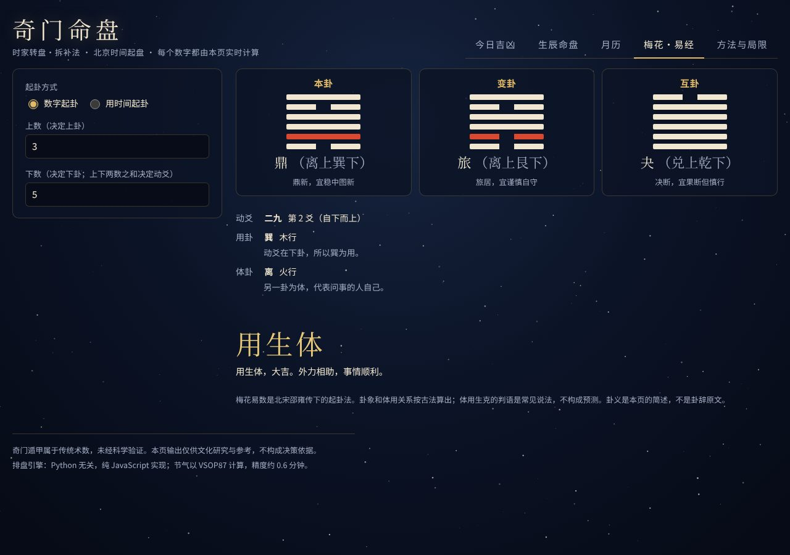

# 奇门命盘

> 输入任意时间，一键排出奇门遁甲盘，看今天十二个时辰的吉凶。单个 HTML 文件，无需安装，离线可用。
>
> *A Qimen Dunjia chart generator in one offline HTML file: pick a time, get the chart and a score for each of the 12 double-hours.*

**👉 [在线体验](https://senhu8888-oss.github.io/qimen-mingpan/)**　|　[下载单文件 dist/index.html](dist/index.html)　|　[欢迎核对结果](VERIFY.md)　|　[English](README.en.md)

## 它能做什么

- **奇门遁甲排盘**：输入任意北京时间，排出时家转盘，给出综合分和十二时辰吉凶；支持拆补法、置闰法、茅山法三种定局方法切换。
- **生辰命盘**：输入出生信息，得到八字（十神、纳音、大运）、命卦和个人运势。
- **紫微斗数**：按出生时间排出命盘（基础部分）。
- **梅花易数**：数字起卦、时间起卦，附六十四卦查看。
- **节气精确到分钟**：用 VSOP87 计算，与香港天文台 2026 年中气比对偏差在 1 分钟内。
- **无依赖、可离线**：整个页面只有一个 HTML 文件，双击就能用；代码开源（MIT）。

觉得有用的话，点一下右上角的 ⭐ Star 就是最大的支持；发现排盘和你信得过的结果不一致，欢迎提 issue。

## 在线使用

仓库已附 `docs/index.html`。想自己部署一个网页：在 GitHub 仓库的 Settings → Pages 里选 Branch `main`、目录 `/docs`，保存后就能得到网页地址。

## 怎么用

- 直接打开 `dist/index.html` 即可。
- 想改代码后重新生成页面：`node build.js`。源文件在 `src/`（样式、模板、页面脚本）和根目录的 `engine.js`（排盘引擎）。
- 运行测试：`npm test`，会检查节气时刻、盘面结构、六十四卦表、梅花起卦、四柱补充、农历换算、紫微安星和三种定局方法。

## 排盘方法

- **时间**：北京时间，23:00 换日，立春换年，节交接换月。可选填出生地经度换算真太阳时。
- **节气**：用 VSOP87 计算太阳黄经，精确到交节的分钟。与香港天文台 2026 年 12 个中气比对，偏差在 1 分钟以内。
- **定局（拆补法）**：节气按精确交节时刻划分；元由当日符头地支决定；局数查 24 节气三元表。
- **布盘**：地盘戊起局数宫；天盘九星随值符星转动；值使门从旬首宫按时辰数走九宫；八神随值符神布。

## 三种定局方法

页面上方可在“拆补法 / 置闰法 / 茅山法”之间切换，默认拆补法。三种方法共用同一张“节气 × 三元”局数表，区别只在于“哪一刻用哪个节气的哪一元”。符头是甲子、己卯、甲午、己酉等甲、己日，每 5 天一个；符头地支子午卯酉为上元，寅申巳亥为中元，辰戌丑未为下元。

| | 拆补法（默认） | 置闰法 | 茅山法 |
|---|---|---|---|
| 节气何时切换 | 精确交节时刻 | 看符头：每个节气从某个上元符头起用 | 精确交节时刻 |
| 元怎么定 | 当天所属符头 | 符头成块，每 5 天一块 | 交节起算，每 60 个时辰（120 小时）一元 |
| 超神、接气 | 只作参考，不影响局 | 符头早于节气为超神，晚于为接气，局随符头走 | 不使用符头，不涉及 |
| 置闰 | 无 | 超神超过上限（默认 9 天）后，在芒种（阳遁）或大雪（阴遁）之后重复该节气三元，共 15 天 | 无 |
| 一天里局会变吗 | 会，在交节时刻变 | 不会，只在符头日变 | 会，在交节时刻和每满 60 个时辰时变 |

页面会显示当前方法、超神或接气天数、是否处于闰期；超神上限和每元时辰数可以在页面里改，也可以在代码里用 `setMethod(方法, 参数)` 或 `chart(ms, { method, params })` 指定。

**待确认的地方**（也写在页面的“方法与局限”里）：
- 茅山法：我查到的两份公开资料都说它“不置闰、不拆补、从交节起用上元”，并没有“以接气为主”的说法，所以按资料实现。120 小时从交节时刻起算，不按整时辰对齐。
- 置闰法：资料没有给出超神的天数门槛，9 天是按需求设的。真实节气间隔不均匀，实际超神、接气天数会略超出“超神最多 9、接气最多 5”的理想范围。置闰没有统一的历史起点，本项目从 1880 年冬至起推，不同软件可能差一轮。
- 1880 年以前或 2102 年以后，置闰法会退回拆补法。

**对比表**：运行 `node compare_methods.js 2000 2030` 会生成 `docs/compare/ju-diff-2000-2030.md` 和同名 CSV，列出三种方法局数不同的日期（取每天北京时间 12:00 的盘）。2000–2030 年共 11323 天，三法不全相同的有 7921 天；拆补与置闰相差 3596 天，拆补与茅山相差 7598 天。

## 其他理论模块

- **梅花易数**（`src/meihua.js`）：数字起卦、时间起卦，给出本卦、互卦、变卦、动爻和体用生克。
- **易经六十四卦**：卦名按文王卦序，配有一句简述的卦义（不是卦辞原文）。
- **四柱补充**（`src/bazi-extra.js`）：十神、纳音、大运。
- **农历换算**（`src/lunar.js`）：不查表，用天文方法算朔，再按“冬至在十一月、无中气置闰”定月序和闰月。已对照 1976–2030 年多个春节和 1990–2033 年的全部闰月，以及中秋、端午，并逐日检查 1990–2050 年日期连续。
- **紫微斗数**（`src/ziwei.js`）：命宫、身宫、十二宫、五行局、紫微与十四主星、左辅右弼、文昌文曲、四化、大限。

## 局限与声明

- **紫微斗数只实现了基础部分**：没有星曜亮度（庙旺）、杂曜和流年。排法按三合派常见规则，庚干四化、闰月归属、晚子时等处各派说法不同。安星公式用教科书结果校验过，但没有拿真实命盘逐项核对。
- **农历朔的精度约 1 分钟**；若朔恰在北京时间零点前后几分钟，日期可能差一天。
- **梅花时间起卦用公历年支、月、日代替农历**，结果可能与传统农历起卦不同，页面上已注明。
- **大运起运按传统口诀折算**：三天折一年，一天折四个月，从出生时刻到最近的节精确计算。这是传统口诀，不是天文事实。
- **体用生克的吉凶判语是常见说法**，不构成预测。

- **拆补法有不同读法。** 本项目采用标准的符头定元加三元表。已知例子：2026-09-11 08:00，日柱戊子，符头甲申属中元，白露三元为九、三、六，所以是阴三局中元；另一个公开排盘页面给阴九局，原因未查明，可能用了超神接气或置闰。本项目没有实现这些方法。
- **阴遁八神的排列**，只确认了阳顺阴逆的方向，完整排法我没有找到可靠原文来核对。
- **吉凶分数是本项目自定的加减规则**，不是传统文献中的固定评分。个人运势同样是本项目设计的组合规则。
- **奇门遁甲未经科学验证。** 本项目仅供文化研究和学习，不应作为任何重要决定的依据。

## 欢迎核对

吉凶分数是本项目自定的规则，没有经过验证，也没有哪本古籍给出过这样的分数。最有用的帮助是：拿你信得过的排盘结果，和本项目对同一时刻的结果比对，不一致的地方请开 issue，写明时刻、你的来源和差异。详见 [VERIFY.md](VERIFY.md)。

## 许可证

MIT，见 [LICENSE](LICENSE)。
